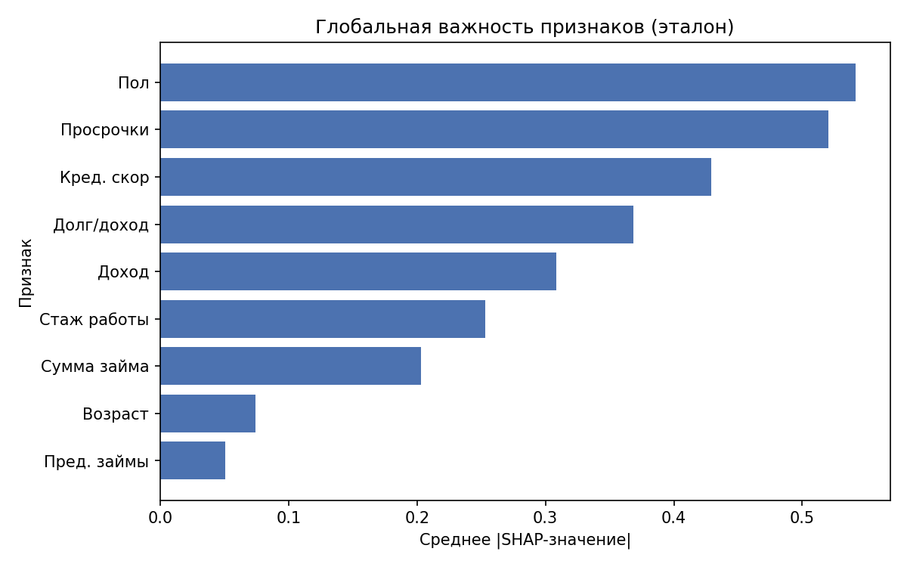
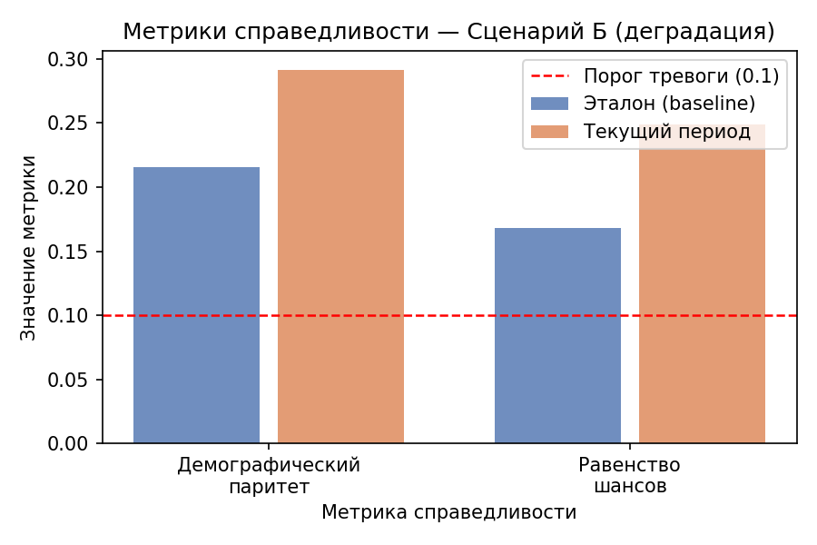

# Мониторинг интерпретируемости и справедливости ML-модели

Система, которая отслеживает, не начала ли модель кредитного скоринга дискриминировать клиентов по полу, и объясняет каждое решение через SHAP. Курсовая работа по дисциплине «Средства интеллектуального анализа данных и машинное обучение», РГУ нефти и газа им. Губкина, 2026.

**Стек:** Python, pandas, NumPy, scikit-learn (GradientBoostingClassifier), SHAP, Fairlearn, FastAPI, matplotlib

## Результаты

- Модель градиентного бустинга на синтетическом датасете (2000 записей, 9 признаков, заложенный дисбаланс по полу): accuracy 0,71, ROC-AUC 0,706. Цель работы — не точность, а мониторинг справедливости, поэтому данные намеренно зашумлены.
- При одинаковых финансовых показателях API даёт вероятность одобрения 80,7% для женщины и 92,0% для мужчины. SHAP-значение признака `gender`: −0,53 и +0,52 соответственно.
- Эталонные fairness-метрики на обучающей выборке: Demographic Parity Difference 0,216, Equalized Odds Difference 0,168 (порог проблемы — 0,1).
- Эксперимент на двух выборках по 500 записей. Сценарий А (норма): разрыв в долях одобрений между группами 24,3%, прирост fairness-метрик ниже порога — алерта нет. Сценарий Б (деградация): разрыв вырос до 51,0%, DPD +0,076 и EOD +0,081 относительно эталона — оба выше порога алерта 0,05, система подняла тревогу.





Полный отчёт мониторинга: `reports/monitoring_report.html` (скачайте и откройте в браузере).

Все генераторы случайных чисел зафиксированы (`seed`), поэтому результаты воспроизводятся при повторном запуске.


## Структура проекта

```
credit_fairness/
├── data/               ← датасет, модель, baseline (создаётся автоматически)
├── scripts/
│   ├── generate_data.py     — генерация синтетического датасета
│   ├── train_model.py       — обучение GradientBoosting
│   ├── compute_baseline.py  — вычисление эталонных SHAP и fairness метрик
│   ├── monitor.py           — модуль мониторинга
│   ├── experiment.py        — эксперимент: сценарии А и Б
│   └── send_requests.py     — 50 тестовых запросов к API
├── api/
│   └── main.py              — FastAPI сервер
├── reports/            ← графики PNG и HTML-отчёт (создаётся автоматически)
└── requirements.txt
```

---

## Пошаговый запуск

### 0. Установка библиотек
Открой терминал в папке `credit_fairness` и выполни:
```
python -m pip install -r requirements.txt
```

### 1. Генерация датасета
```
python scripts/generate_data.py
```
Создаёт: `data/credit_data.csv`

### 2. Обучение модели
```
python scripts/train_model.py
```
Создаёт: `data/model.pkl`, `data/scaler.pkl`, `data/X_train.pkl`, `data/y_train.pkl`, `data/feature_cols.json`

Файлы `.pkl` не хранятся в репозитории — они создаются на этом шаге.

### 3. Вычисление baseline-метрик
```
python scripts/compute_baseline.py
```
Создаёт: `data/baseline_metrics.json`, графики в `reports/`

### 4. Запуск API-сервера
```
cd api
python -m uvicorn main:app --reload --port 8000
```
Открой браузер: http://localhost:8000/docs

Тестовый запрос (в новом окне cmd):
```
curl -X POST http://localhost:8000/predict -H "Content-Type: application/json" -d "{\"age\":35,\"gender\":0,\"income\":55000,\"credit_score\":680,\"loan_amount\":12000,\"employment_years\":5,\"debt_to_income\":0.3,\"num_prev_loans\":1,\"num_defaults\":0}"
```

### 5. Эксперимент (сценарии А и Б)
Остановить API (Ctrl+C), вернуться в корень проекта:
```
cd ..
python scripts/experiment.py
```
Создаёт: графики в `reports/` и `reports/monitoring_report.html`

Открой `reports/monitoring_report.html` в браузере — это итоговый отчёт.

---

## Что делает каждый скрипт

| Скрипт | Что делает |
|--------|-----------|
| `generate_data.py` | Создаёт синтетический датасет 2000 записей с намеренным дисбалансом против женщин |
| `train_model.py` | Обучает GradientBoostingClassifier, сохраняет модель и scaler |
| `compute_baseline.py` | Считает SHAP-значения и fairness-метрики на обучающей выборке (эталон) |
| `monitor.py` | Сравнивает текущие данные с baseline, генерирует алерты |
| `experiment.py` | Генерирует два сценария и запускает сравнительный мониторинг |
| `send_requests.py` | Отправляет 50 тестовых запросов к запущенному API (25 женщин и 25 мужчин с одинаковыми показателями) |
| `api/main.py` | REST API: предсказание + локальный SHAP + fairness по накопленным запросам |
